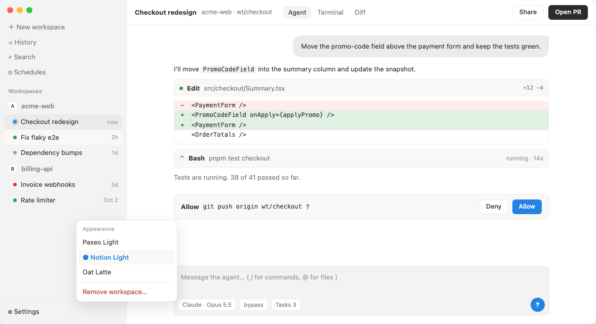

# Notion Light for Paseo

A light [Paseo](https://paseo.sh) theme using the colors of Notion's light theme.



## Install

```bash
paseo plugin add git:jnak/paseo-notion-light-theme
```

Then pick **Notion Light** under Settings → Appearance.

## Colors

| Paseo | Value | Notion token |
|---|---|---|
| background | `#ffffff` | `--c-bacPri` |
| foreground | `#2c2c2b` | `--c-texPri` |
| raised | `#f9f8f7` | `--c-bacSec` |
| control | `#f4f3f3` | `--c-bacInt` |
| border | `#ebebe9` | `--cl-palGra90` (on white) |
| accent | `#2383e2` | `--c-palUiBlu600` |
| mutedForeground | `#7d7a75` | `--c-texSec` |
| ring | `#a19e99` | `--c-texTer` |

Unofficial; not affiliated with or endorsed by Notion.
